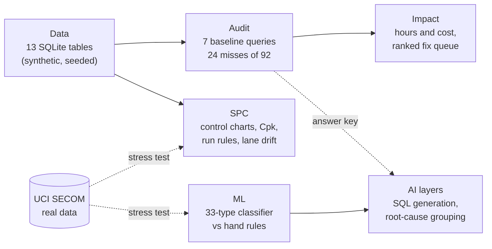

# Architecture

OpsAudit is a static React site over an in-browser SQLite database, plus a separate Python pipeline for machine learning and real-data analysis. There is no backend. Every number on the site is either computed in the browser from the seeded data or read from a results file that a script wrote.

Read it left to right as the order of the tabs. Solid arrows are real data dependencies; dotted arrows are grading (the audit's hand-written baselines are the answer key for the AI layers) or validation (SECOM tests the SPC and classification methods on real data).

## Data

`src/db/` builds a SQLite database in the browser with sql.js from seeded generators in `src/db/seed/`. There are 13 tables: six candidate tables (ports, batches, tools, holds, scheduled checks, notifications), the automation's activity log, a platform availability log, and the station network and measurement tables. Every seeder has its own random stream, so editing one table cannot reshuffle another. The planted cases (an outage, bypasses, look-alike clusters) are written out literally in the seeders. `npm run db:check` loads the same rows under Node and verifies the tables, the constraints and the counts.

## Audit

`src/db/baselines.js` holds seven hand-written SQL queries, one per automated procedure, each reconstructing what should have been picked up from raw history and anti-joining it against the activity log. A miss means the case was never picked up, whatever happened afterward. `src/db/house-rules.js` checks properties of detection SQL (a bypass is attributed, never used to filter), and `src/db/expected-findings.js` is the hand-written root-cause answer key. `db:check` confirms 92 qualifying cases, 68 logged and 24 missed, and fails if any procedure returns zero misses.

## Statistical process control

`src/spc/spc.js` is a dependency-free module: X-bar/R and individuals charts, Cp/Cpk/Pp/Ppk, Western Electric and Nelson run rules, and a control chart on the difference between two stations that should agree. Limits come from a baseline window and are held fixed. `src/db/seed/measurements.js` plants a gradual drift, a one-subgroup spike and a wide-spread station. `npm run spc:check` verifies the math against hand-worked answers, that each rule fires on a constructed pattern, and that the planted problems are found.

## Impact

`src/impact/impact.js` converts misses into labor hours and cost at risk using assumptions that are all editable on the Impact tab, then groups misses into fixes and ranks them by cost, hours or payback. `src/impact/misses.js` collects miss records from the baselines. `npm run impact:check` verifies that every miss lands in exactly one fix, that totals reconcile three ways, and that the model moves the right direction when an assumption changes.

## Machine learning

`ml/` is Python (pandas, scikit-learn). `taxonomy.py` defines 6 kinds of check and 33 specific types; `generate_data.py` writes 50 messy labeled records per type (four languages, missing fields, mixed units, noisy overlapping thresholds). `features.py` and `rules.py` never import the taxonomy, so the answers stay out of the code being tested. `train.py` does one stratified split, tunes by cross-validation on the training set only, scores the test set once, and writes `ml/results/results.json`, which the ML tab imports. `ml/ci_smoke.py` is the fast check used in CI.

## AI layers

`src/engine/generate-sql.js` turns a messy procedure document into detection SQL in three separate model calls (resolve, extract, compose); `src/engine/diagnose.js` groups misses by root cause in one call. `score.js` and `diagnose-score.js` grade the output against the baselines and the answer key, and both scorers have self-tests that feed deliberately wrong answers through. The model calls happen only in Node (`gen:check`, `diag:check`, with `--save`), which writes `src/ai/results/*.json`; the browser never holds a key and only displays the saved results.

## Real-data stress test

`ml/real/` runs individuals charts, time-split classification and a bridge to the audit on the public UCI SECOM dataset. `download_secom.py` fetches the raw files into a gitignored folder, and `secom_analysis.py` runs under `python -I`, with every choice fixed in its header before any result is seen. Results go to `ml/real/results/secom_results.json`, shown on the Real Data tab.

## Site and delivery

`src/App.jsx` and `src/components/` are presentation only; logic lives in the modules above. The Overview tab computes its headline numbers from the same sources as the detail tabs. GitHub Actions runs every check, the build and the ML smoke test on each push (`.github/workflows/ci.yml`) and deploys `dist/` to GitHub Pages (`deploy.yml`). `vite.config.js` uses a relative base so the site works from any Pages path.
