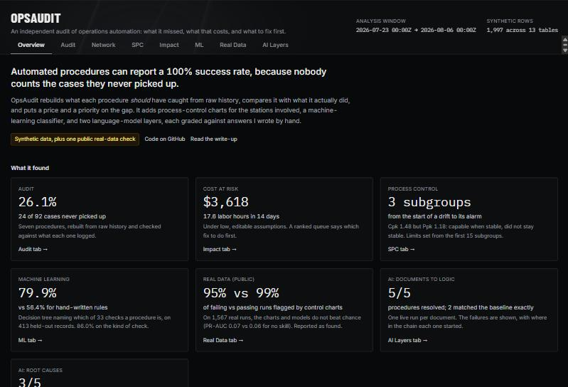

# OpsAudit

[](https://github.com/dstew2816/ops-audit/actions/workflows/ci.yml)

**Finds the cases operations automation silently misses, puts a price on them, and ranks what to fix first.**



**Live demo: https://dstew2816.github.io/ops-audit/**

This is a demo of the kind of work I did at TSMC. Everything is synthetic data, except one clearly labeled check on a public dataset.

## Why this exists

Automated procedures watch for a condition, such as a port blocked for 30 minutes, and act on it. They run on live events and cannot replay history. If the platform is down, an event arrives late, or a rule is slightly too narrow, the case is never picked up, and nothing records that it was missed.

Success rates are calculated over the cases that were handled, so a procedure can report 100% while missing a quarter of what it should have caught. OpsAudit rebuilds what should have happened from raw history, compares it with what the automation did, and turns the gap into hours, dollars and a fix list.

## What it found

- **The audit.** Seven automated procedures, 92 qualifying cases, **24 never picked up (26.1%)**.
- **The cost.** About **17.6 labor hours and $3,618 at risk** in 14 days, under deliberately low assumptions you can edit on the page. One fix, an outage backfill, covers 8 of the 24 misses and about half the cost.
- **Process control.** A drift I planted in one station was flagged 3 subgroups after it began. A second chart, on the gap between two stations that should agree, caught it at 22.
- **Machine learning.** A decision tree reads a messy procedure definition and names which of 33 kinds of check it is, right **79.9%** of the time on 413 held-out records. Hand-written rules get 56.4% to 66.3%.
- **Real data.** I ran the same methods on a public set of 1,567 real production runs (UCI SECOM). They did **not** separate failures from passes, and the site says so.
- **AI layers.** A language model resolved the right procedure from a messy document 5 times out of 5 and recovered a six-hour outage cluster exactly. It also made mistakes, and the site shows where.

## What is in the site

| Tab | What it shows |
|---|---|
| Overview | The headline numbers, each linked to its detail |
| Audit | What was missed, per procedure, with the query behind every number |
| Network | A seven-station route and where batches wait |
| SPC | Control charts, capability and alerts, plus drift between parallel stations |
| Impact | Hours and cost at risk, every assumption editable, and a ranked fix queue |
| ML | A learned classifier against hand-written rules, with a confusion matrix |
| Real Data | The same methods on public production data |
| AI Layers | Two language-model layers graded against hand-written baselines, failures included |

## Why you can trust the numbers

- **Graded against answers written first.** The audit queries, the root-cause key and the hand rules were fixed before any model was trained, and nothing was adjusted after seeing results.
- **Scorers that can fail.** Each scorer is tested with deliberately wrong answers, including the answer a plain group-by-time would give.
- **Test sets scored once.** On real data the split is by time, so the model is tested on runs it could not have seen.
- **Weak results stay in.** Intervals are shown, and the real-data and AI shortfalls are on the page, not buried.
- **Everything is checked on every push.** GitHub Actions runs all the checks, the build and a machine-learning smoke test.

## Try it

Open the live demo and start on the Overview tab. To run it yourself:

```
npm install
npm run dev                          # the site at http://localhost:5173
npm run check                        # every check, no API calls

python -m pip install -r ml/requirements.txt
python ml/generate_data.py           # the ML dataset
python ml/train.py                   # trains and scores the ML pipeline
python ml/real/download_secom.py     # fetch the public SECOM data (not committed)
python -I ml/real/secom_analysis.py ml/real/data/secom
```

The live AI runs need an API key in your shell (`npm run gen:check -- --save`, `npm run diag:check -- --save`). The site only displays saved results, and the browser never holds a key.

## Where else this applies

An audit like this needs two independent sources anywhere it runs: (a) raw events showing that a condition happened, and (b) the automation's own record of what it did. A silent miss is a gap between the two.

| Domain | The rule | The silent miss | The two sources you'd need |
|---|---|---|---|
| Warehouse inventory | Stock falls below the reorder point, so a purchase order should be created | Stock fell below the point and no purchase order exists | Inventory snapshots + purchase order log |
| Shipping and logistics | A shipment passes its delay threshold, so an exception ticket or customer alert should go out | The shipment was delayed and no ticket or alert exists | Carrier tracking events + ticketing and notification log |
| Quality holds | A hold expires, so the lot should be released or escalated | The hold expired and the lot sat untouched | Hold records + lot movement log |
| Customer service and IT operations | A ticket breaches its service-level target, so it should escalate | It breached and never escalated | Ticket timestamps + escalation log |
| Banking operations | A complaint or dispute passes its response deadline, so it should get a response or escalate | It passed the deadline with no response | Complaint intake records + response log |

Running the audit outside this project means getting both sources and agreeing on the rule's exact definition first; in practice the hard part is access to the automation's own log, not the detection logic. Public datasets rarely include both sources, which is why the audit itself uses synthetic data here, with a separate real-data stress test on the UCI SECOM dataset for the statistical process control and classification methods.

## Limitations

- **Synthetic and small.** 24 misses, 7 stations, one 14-day window, a 413-record ML test set, and one recorded run of each AI layer. The numbers show that a method works. They are not a benchmark or a forecast.
- **I wrote the answer keys,** so their vocabulary overlaps with the generators and the rules. Real documents would be harder, and the ML accuracy leans optimistic.
- **The real-data result is weak.** The SECOM sensors are anonymized and not stable even inside the baseline, there are no specification limits, and only 26 failures fall in the test period.
- **The dollar figures are assumptions,** not measurements.
- **The AI results are one sample each.** A different run could score differently. The first stage's prompt was changed once before the recorded run, because the API intermittently refused a request to explain its own reasoning. Nothing was changed after seeing scores.

Detail on each point is in [ml/README.md](ml/README.md) and on the Real Data and AI Layers tabs.

## Data sources and credits

- **UCI SECOM** (Real Data tab, `ml/real/`): McCann, M. & Johnston, A. (2008). SECOM [Dataset]. UCI Machine Learning Repository. https://doi.org/10.24432/C54305. Licensed under CC BY 4.0. The raw files are not committed; `ml/real/download_secom.py` fetches them. The results file includes the readings of 8 charted sensors as derived data, credited to the source.
- Everything else is synthetic and generated by the code in this repository.

## Built with

JavaScript, React, Vite and SQLite (sql.js) for the site. Python, pandas and scikit-learn for the ML and real-data work. Claude (Anthropic API) for the two AI layers.

I chose the problem and the evaluation rules (baselines and rules frozen before training, a time split on real data, no tuning on test sets). Claude Code, an AI coding assistant, wrote most of the code and drafted the answer keys and hand rules.

More: [ARCHITECTURE.md](ARCHITECTURE.md) for how the modules fit together, and [guide.md](guide.md) for working in the codebase.
