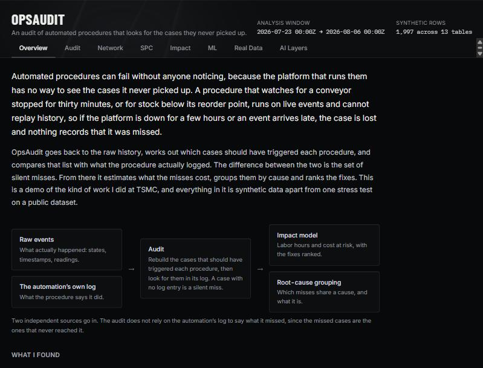

# OpsAudit

[](https://github.com/dstew2816/ops-audit/actions/workflows/ci.yml)

Automated procedures can fail without anyone noticing, because the platform that runs them has no way to see the cases it never picked up. OpsAudit rebuilds from raw history what those procedures should have done, compares that with what they actually did, and estimates what the gap costs and which fix to make first.

Live demo: https://dstew2816.github.io/ops-audit/

This is a demo of the kind of work I did at TSMC. Everything in it is synthetic data, apart from one stress test on a public dataset.



## The problem

An automated procedure watches for a condition and reacts to it: a conveyor stopped for thirty minutes, stock below its reorder point, a hold that has expired. These procedures run on live events and cannot replay history, so if the platform is down or an event arrives late, the case is never picked up and nothing records that it was missed. Success rates count only the cases that were handled, so a procedure can report 100% while missing a quarter of what it should have caught.

## What I built

- **An audit.** Seven database queries, one per procedure, rebuild the cases that should have triggered it and look for them in its log.
- **Statistical process control (SPC).** Control charts for each station, with limits set from an early baseline and then held fixed, plus a chart of the gap between two stations that should agree.
- **An impact model.** Each miss becomes labor hours and cost at risk, using assumptions you can edit, and the fixes are ranked.
- **A machine learning (ML) classifier.** It reads messy procedure definitions and says which of 33 kinds of check each one is. Hand-written rules, frozen before training, are the comparison.
- **Two AI layers.** One writes the detection query from a process document, in three separate calls so a failure can be traced to a step. The other groups misses by root cause.
- **A stress test on real data.** The same SPC and classification methods, run on a public semiconductor dataset (SECOM).

## What I found

Of 92 cases that should have triggered a procedure, 24 were never picked up (26.1%). Under deliberately low assumptions that is about 17.6 labor hours and $3,618 at risk over 14 days, and a backfill after one platform outage covers about half of it.

A drift I planted in one station raised an alert three subgroups after it began. The decision tree names the right kind of check for 79.9% of 413 held-out definitions, against 56.4% to 66.3% for the hand-written rules. The AI layers had mixed results in a single recorded run: the first resolved the right procedure for all five documents but matched the hand-written query exactly on two, and the second recovered the outage cluster exactly but passed three of its five checks.

The stress test on real data was weak. 95.0% of failing runs were flagged by the control charts, but so were 98.8% of passing runs, and no classifier clearly beat chance (precision-recall area under the curve of 0.06 to 0.07, against 0.055 for no skill, with 26 failures in the test period). The sensors were already unstable inside the baseline window, and a plain individuals chart assumes independent, normally distributed readings. I did not correct for that.

## Limitations

I built the synthetic data and wrote the answer keys, so the classifier's accuracy probably overstates what real documents would give. Every sample is small, each AI layer was run once, and the dollar figures come from assumptions I chose. [ml/README.md](ml/README.md) and the tabs on the site give the details.

## Run it

```
npm install
npm run dev                          # the site at http://localhost:5173
npm run check                        # every check, no API calls
python -m pip install -r ml/requirements.txt
python ml/train.py                   # the ML pipeline
python ml/real/download_secom.py     # fetch the public data (not committed)
python -I ml/real/secom_analysis.py ml/real/data/secom
```

GitHub Actions runs the checks, the build and a fast ML smoke test on every push (continuous integration, or CI). The live AI runs need an application programming interface (API) key in your shell; the site only displays saved results.

## Where else this applies

An audit like this needs two independent sources: (a) raw events showing that a condition happened, and (b) the automation's own record of what it did. A silent miss is a gap between the two.

| Domain | The rule | The silent miss | The two sources you'd need |
|---|---|---|---|
| Warehouse inventory | Stock falls below the reorder point, so a purchase order should be created | Stock fell below the point and no purchase order exists | Inventory snapshots + purchase order log |
| Shipping and logistics | A shipment passes its delay threshold, so an exception ticket or customer alert should go out | The shipment was delayed and no ticket or alert exists | Carrier tracking events + ticketing and notification log |
| Quality holds | A hold expires, so the lot should be released or escalated | The hold expired and the lot sat untouched | Hold records + lot movement log |
| Customer service and IT operations | A ticket breaches its service-level target, so it should escalate | It breached and never escalated | Ticket timestamps + escalation log |
| Banking operations | A complaint or dispute passes its response deadline, so it should get a response or escalate | It passed the deadline with no response | Complaint intake records + response log |

In practice the hard part is access to the automation's own log, not the detection logic. Public datasets rarely include both sources, which is why the audit uses synthetic data here and the real-data stress test covers only the SPC and classification methods.

## Credits

Real-data stress test: McCann, M. & Johnston, A. (2008). SECOM [Dataset]. University of California, Irvine (UCI) Machine Learning Repository. https://doi.org/10.24432/C54305. Licensed under Creative Commons Attribution 4.0 (CC BY 4.0); the raw files are not committed. Built with JavaScript, React, Vite and SQLite (sql.js) for the site, Python (pandas, scikit-learn) for the ML work, and Claude for the two AI layers. [ARCHITECTURE.md](ARCHITECTURE.md) describes how the modules fit together.
